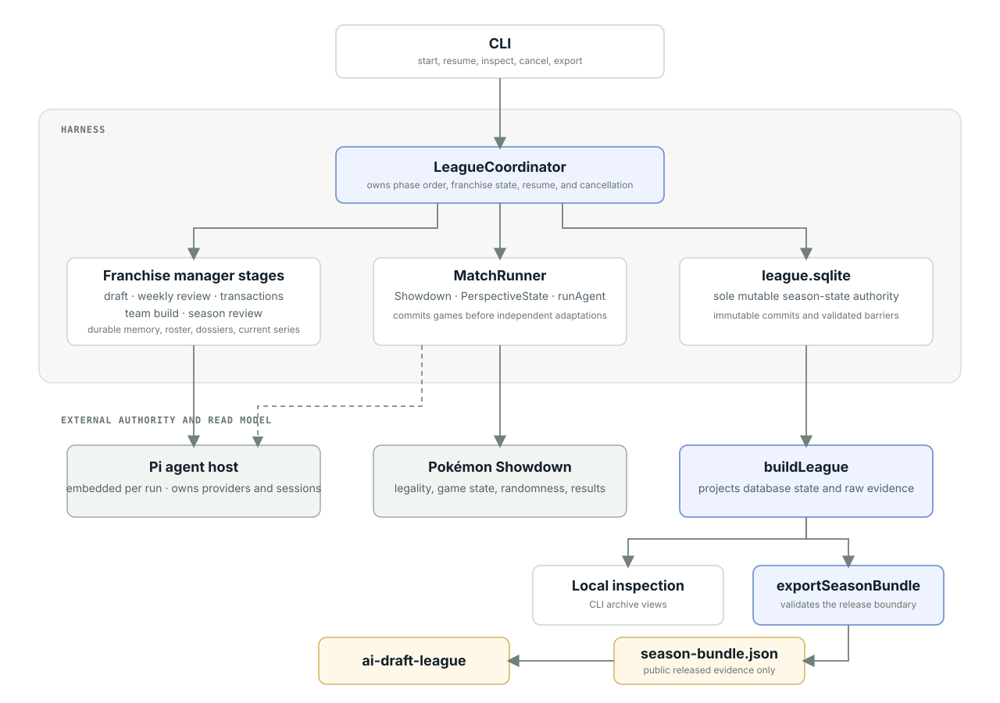

# Understand the harness architecture

The harness separates season orchestration, model calls, battle simulation, persistence, and publication. Each boundary has one authority.

<figure class="doc-diagram">
  
  <figcaption>The run directory connects execution, local inspection, and public export. The agent host reaches model providers through pi-ai; Pokémon Showdown remains external.</figcaption>
</figure>

See [Franchise manager state](manager-model.md) for the context supplied to model calls.

## Orchestrate and persist a run

`runDraftLeague` constructs one `LeagueCoordinator`, which owns phase order and carries one cancellation signal through the run. Its `FranchiseState` entries keep each coach's durable memory, roster and budget, opponent dossiers, and series notes together. Stage functions (draft, team build, series, weekly review, transaction window, reconciliation, playoffs, season review) each adopt what the database already holds before doing new work, so resuming a run is re-running the season from the draft: completed stages replay without provider calls and the first unfinished stage continues.

`league.sqlite` owns league state: validated transitions, immutable roster versions, draft choices and names, franchise memory checkpoints, team builds, transaction events and results, series identities and attempts, agent context, resolved games, independent per-side adaptations, and season reviews. Each private conversation is an append-only transcript in `agents/<session>.jsonl`. `config.json` is the readable run specification: models and seating, seed, board and format, Showdown revision, concurrency, timer and sheet policy, schedule, transactions, and provider specifications. Only explicit promotion from draft-only mode changes the specification.

Decision and trace files project native execution and simulator outcomes. Decision latency comes from the native task-to-accepted-submission timestamps; recovery time is recorded separately. Exports and the mechanics monitor select traces by the submissions belonging to each game's resolving attempt. Resume verifies each referenced canonical game log by digest. A finished series is adopted as recorded, so later changes to prompts or briefings never invalidate played games; an unfinished series resumes only under the identity it started with, because its remaining games replay from it. `records/results.jsonl` is a cross-run projection of completed series, appended once per series and regenerated from the database when missing.

This is a clean protocol cutover. Runs created before `league.sqlite`, fallback-era checkpoint databases, repaired team-build artifacts, and raw-memory series identities are not resumable without an explicit offline migration. The harness rejects these layouts rather than guessing at their meaning; it does not alter old runs.

## Resolve battles

`MatchRunner` runs a best-of-three against the pinned simulator. Pokémon Showdown decides team legality, accepted actions, randomness, battle transitions, timers, and results. League code enforces draft ownership, budgets, roster size, and Mega Evolution locks.

The team-build referee owns submission parsing, evidence limits, roster constraints, and canonical action construction. Both model submissions and directly generated random sets pass through it. Artifact replay reconstructs the same action and compares its packed bytes and roster labels with the stored artifact.

For each game, `MatchRunner` commits Showdown's result, canonical log digest, and both prepared adaptation tasks before calling either coach. Each adaptation is independently durable. A restart completes only missing adaptations and never replays a resolved game. If the external result projection was interrupted, it is rebuilt from the completed database series. The next game starts only after both adaptations are complete.

An unresolved untimed game replays from its seed, recovering accepted submissions from the session transcript without inference until it reaches the unfinished task. Recovery compares stored prompts and rules before validating a submission against the current menu. The random baseline is seeded per game. Timed games use a new conversation for each attempt: the elapsed clock and timer substitutions are not yet checkpointed. The player's history tool selects observations after the latest start of each game so a restarted game cannot retrieve its abandoned future.

`PerspectiveState` consumes only the requesting side's Showdown protocol stream. It is the authorized model projection, never outcome authority and never a second simulator.

Battle damage and action-order tools accept explicit Mega scenario flags. They resolve the known stone through Showdown's species mapping and project the new forme, ability, and raw stats while holding the current field and boosts fixed. Exact projected stats are used where the visible pre-Mega stats determine them; ambiguous and opposing stats retain legal ranges. These conditional projections leave the live observation unchanged.

All model stages run through the run's `AgentRuntime.run`, a league-owned loop on [Pi](https://github.com/earendil-works/pi): `pi-agent-core` drives turns and tool execution and `pi-ai` speaks each provider's protocol. The league supplies authorized context, reference tools, and a typed submission tool. Reference tools are exposed through Code Mode (`pi-codemode`, a QuickJS sandbox): the model sees one `execute` tool and a catalog of typed declarations rendered into its instructions, so one reply can run many lookups concurrently instead of paying a full conversation replay per call. The submission tool stays a direct tool. Each `execute` result records every inner call with its result, so decision traces and the mechanics monitor keep one row per lookup. One Zod schema defines each stage's advertised reply shape and validates its submission; domain checks return actionable tool errors rather than silently repairing an action. The league advertises its schemas open and rejects undeclared fields by name, so a misnamed field is an error to correct, never a silently omitted one. An accepted submission ends the turn loop, and it is durable in the transcript before it is returned. A reply that ends without an accepted submission is reminded twice to call its submission tool before the stage fails. Five rejected submissions stop the task. Untimed play has no wall-clock deadline; the optional Showdown clock remains the gameplay deadline.

Each game has one continuous private conversation, including its post-game review. Every task on a session shares the same instructions and tool definitions, including both submission tools, and per-task instructions ride in the user message: the provider cache prefix is the system prompt plus the tool definitions, so a changed review system prompt or a slot count baked into the action schema would re-bill the whole game. Transaction-window tasks run in separate sessions because each phase has its own rules and the prompt re-supplies the coach's earlier words. Decisions append current state and new observations; new games receive strategic notebook fields and the build briefing. `read_battle_history` retrieves original private observations, submitted choices and stated reasons, and reviews across the series. Decision traces project usage, tool inputs, and results from the transcript.

`withAgentHost` opens one host per run directory and hands every stage an `AgentRuntime`: `run` executes one task and `live` publishes spectator games. Each session is a JSONL transcript whose header pins the model, reasoning level, and OpenRouter routing; a resumed session with a different configuration is rejected. Every task appends a task record and then each finalized message. Recovery reads only this transcript: an accepted submission is returned without inference, a changed prompt or system prompt is rejected, an unfinished task resumes where its transcript ends, and a later task cannot start while an earlier one is unfinished unless it explicitly supersedes it. A system prompt that changes between tasks is appended as a named section update; providers that cannot take mid-conversation system messages receive the replayed prompt as the leading message.

The model sees only coaching instructions and league tools. Claude models are cached through each provider's native protocol, keyed by the private session. OpenRouter disallows fallback routing and optionally pins one upstream. pi-ai classifies transient provider errors; the runtime retries them up to four times with backoff, resamples Gemini malformed function calls and Anthropic refusals, and never retries during a timed decision. A failed reply stays in the transcript for usage and reasoning accounting but is never replayed to the model.

Before a task's first request, a conversation whose last reply came within 24,000 tokens of the model's context window is compacted: the model writes a checkpoint under fixed headings, and the transcript keeps the system prompt, the checkpoint, and a recent tail of up to 12,000 tokens that starts at an assistant reply. The checkpoint instructions preserve notebook fields, revealed-set facts, uncertainty, game scope, and the distinction between a submitted and simulator-accepted action. Compaction spend counts toward the task that triggered it.

`onAgentProgress` projects agent events into one activity per session: `starting`, `generating`, `reasoning`, `tool` (with the tool name), `retry`, `compacting`, or `ended`, plus the session's cost and token usage once known. It exposes lifecycle and spend without prompts, reasoning text, or tool arguments. `--progress` prints these updates during a run. Every run also writes a coalesced `live.json` snapshot with active sessions and the latest public Showdown game per series; readers derive the run state (running, done, failed, stopped) from the run's `status.json`. This is a disposable spectator projection; canonical completion evidence still comes from session transcripts and Showdown.

The site's dev server watches atomic snapshot replacements and streams them over SSE. Reconnecting receives the current snapshot; a resumed run starts a new generation. The live screen works before a season export exists and appends public battle lines to the existing Showdown player. Draft and series transitions invalidate the season pages instead of polling and rebuilding exports on a timer. The CLI monitor reads completed evidence for post-run audits.

Archive game readers accept completed series only. Live watch replaces the old decision-log scanning, reconstructed battlefield snapshots, inferred timers, and unfinished-series lookup paths.

`showdown.lock.json` names the full official commit. Setup verifies the installation before a run starts.

## Read and publish data

`league-store` reads the run specification and draft state for resume. `buildLeague` joins the run database, series evidence files, and series records for local inspection and export. The spectator app's development server can read run directories through `/api/watch`; public pages read only exported bundles.

`exportSeasonBundle` is the only publication path. It requires an explicit release boundary, validates the projection, and writes `season-bundle.json`. Every planned series in a released week must be complete and have verified replay evidence. Each boundary step past the regular season adds one playoff round; a boundary containing the final also releases season reviews and opens closed sheets.

The bundle includes released rosters, builds, standings, games, decisions, transactions, reviews available at that boundary, and the bracket. Prompts, model responses, reasoning, and tool results from released games are published separately as decision traces. These can include model memory and team details. Gameplay visibility is enforced in the inputs supplied to each model; spectator trace publication does not change those inputs. Credentials and future results are excluded.

## Enforce trust boundaries

- Setup verifies the Showdown pin before execution
- Credentials come from the environment through pi-ai and never enter model prompts, transcripts, or public bundles
- Run and series identifiers are validated before filesystem access
- User cancellation aborts the in-flight request; pi-ai classifies provider errors and the runtime owns retries
- The optional Showdown timer owns gameplay deadlines

## Open work

- Structured, metered one-shot generation: the pinned `generate.text` accepts only a prompt/model and returns text. Franchise naming can move when it exposes validation and usage; season reviews still use dex tools to check facts
- Decision forks for audits: pair `session.fork` with Showdown replay to the same decision boundary and copy the matching notebook/perspective state
- Upstream-provider telemetry through a native SDK metadata field, avoiding a second provider-stream parser
- Whole-release transactional publication: exports replace files atomically, but a release is not yet one transaction
- Exact recovery of an unresolved timed game, including clock consumption and timer substitutions
- A verified frame bridge between the replay animation and the decision list
- Notebook diffs on team timelines, which need notebook text snapshots in the public artifact
